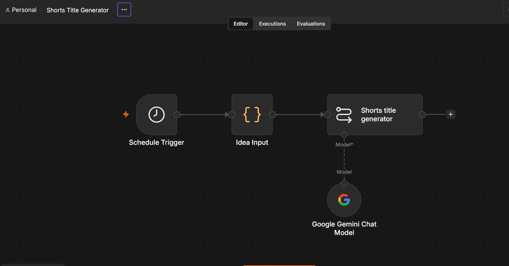

# Daily Shorts Idea Pipeline

An n8n workflow that runs every day at 9:15 AM, takes a list of video ideas, and uses Google Gemini to generate 5 YouTube Shorts titles for each idea.

## How it works

1. **Schedule Trigger** starts the workflow daily.
2. **Idea Input** (Code node) provides a list of video topics.
3. **Shorts title generator** (Basic LLM Chain) asks Gemini for 5 titles per idea.
4. **Google Gemini Chat Model** supplies the AI model.

## Setup

1. Install n8n: `npx n8n`
2. Import `Shorts_Title_Generator.json` in n8n (Workflow menu > Import from file).
3. Create a Google Gemini credential using your own API key from Google AI Studio. Never put the key in the workflow file.
4. Edit the ideas in the Idea Input node to match your topics.
5. Publish the workflow.

## Screenshot

## What I learned

Setting up the Gemini credential was the hardest part, since the API key kept failing until I created a fresh key. I also learned that Schedule Triggers only run once the workflow is published, and I put my Code node’s JavaScript inside an Edit Fields node by mistake, which caused an error, not an Edit Fields node. Next time I'd add a CSV export so the titles are saved automatically.

## Next steps

- Split the titles into one row per item
- Save results to a CSV file
- Add error handling for API limits